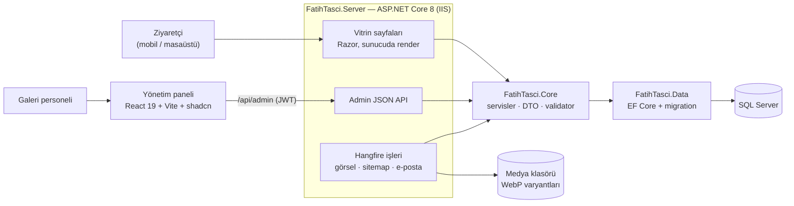
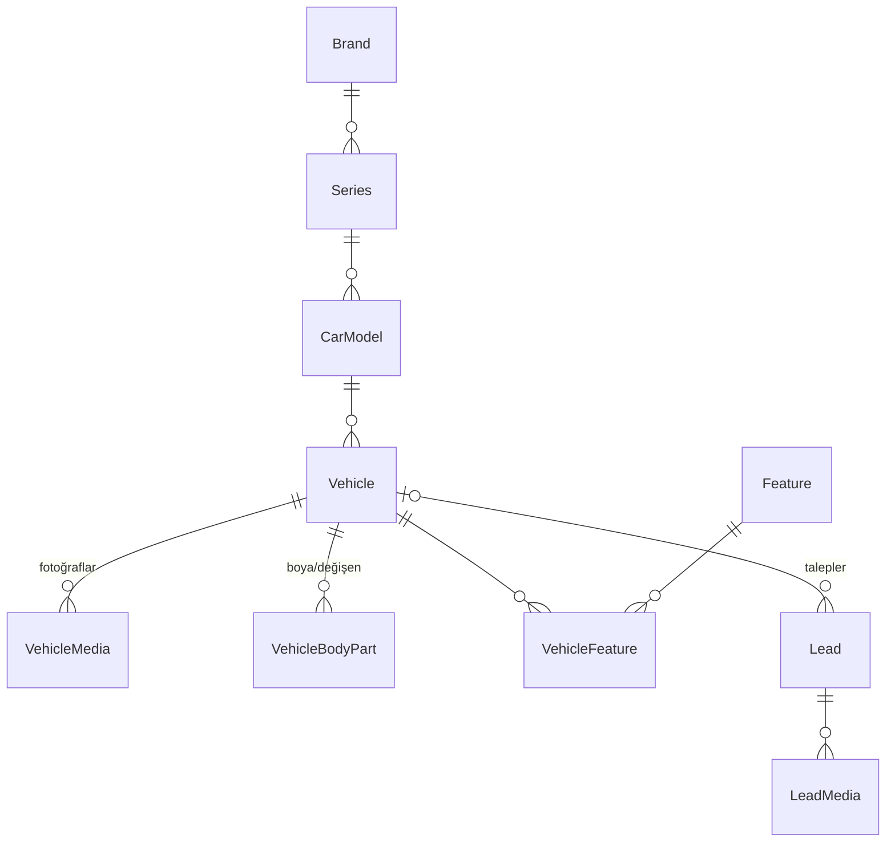

# Premium Oto Galeri — Proje Dokümanı

> Taslak v0.1 · 13 Kasım 2026

Tek bir galeriye ait, premium ("elegance") hissi veren bir **vitrin sitesi** ile araçların Sahibinden ayrıntısında girildiği bir **yönetim paneli** yapılacak. Altyapı olarak Signage'ın (GoraDigitalSignage) .NET 8 + EF Core + SQL Server + React yapısı kullanılacak; **tenant sistemi ve çoklu dil olmayacak**.

---

## 1. Amaç ve kapsam

**Amaç:** Galerinin stoğunu en iyi şekilde sergilemek, her aracı alıcının sorabileceği tüm ayrıntılarla göstermek ve gelen talepleri (arama, WhatsApp, form) toplamak.

**Kararlaştırılanlar**

- Tek galeri: çoklu firma (tenant) yapısı yok.
- Yalnızca Türkçe: site ve panelde dil seçeneği yok.
- Signage'ın altyapısı ve kodlama kuralları temel alınacak.

**Şimdilik kapsam dışı (varsayım, değişebilir)**

- Pazar yeri özellikleri: üyelik, bireysel ilan verme.
- Online ödeme / kapora.
- İlan portallarına (Sahibinden, arabam.com) otomatik aktarım. Faz 3'te araştırılacak.

---

## 2. Mimari

### 2.1 Genel yapı

| Proje | Görevi |
|---|---|
| `FatihTasci.Core` | Entity, enum, DTO, servis, FluentValidation validator'ları |
| `FatihTasci.Data` | EF Core `DbContext`, migration'lar, seed (marka/seri/model, donanım listesi) |
| `FatihTasci.Server` | Vitrin sayfaları (Razor), `/api/admin/*` JSON API, görsel işleme, Hangfire |
| `FatihTasci.Admin` | Yönetim paneli (React 19 + TypeScript + Vite + shadcn/ui). Derlenmiş hali Server üzerinden `/panel` altında sunulur |

Proje adları geçicidir, galeri adı netleşince değiştirilebilir.

### 2.2 Signage'dan farklar

| Konu | Signage | Galeri |
|---|---|---|
| Firma yapısı | Çoklu firma: `UserTenants`, `X-Tenant-Id`, `TenantResolutionMiddleware`, `ITenantProvider`, tenant-gate ekranı | **Yok.** Tenant katmanının tamamı çıkarılır |
| Dil | i18next (tr/en), tüm metinler `t()` ile | **Yalnızca Türkçe.** i18next kurulmaz, metinler doğrudan yazılır. CLAUDE.md'deki 8. kural (no magic strings) bu projede geçerli değildir |
| Cihaz tarafı | Node player, WebSocket, Device auth, eşleştirme | Yok |
| Kayıt / Google ile giriş | Bayraklarla açılıp kapanır | Yok. Panel kullanıcıları seed ile ya da yönetici tarafından eklenir |
| Kamuya açık site | Yok (yalnızca landing page) | **Yeni:** sunucuda render edilen vitrin sitesi |

### 2.3 Signage'dan alınacaklar

- **Kimlik doğrulama:** Identity + JWT girişi (tenant'sız hali).
- **Backend düzeni:** `ServiceResultModel<T>`, `GlobalExceptionHandler`, UnitOfWork, FluentValidation'ın aynı dosyada yazılması, `record` kullanılmaması, AutoMapper.
- **Görsel işleme:** SixLabors.ImageSharp (Signage'da zaten var). Yüklenen her fotoğraf için WebP varyantları üretilir: küçük (480 px), orta (1280 px), büyük (2400 px). İsteğe bağlı filigran eklenir.
- **Arka plan işleri:** Hangfire. Görsel işleme, sitemap üretimi ve bildirim e-postaları için.
- **E-posta şablonları:** Razor.Templating (Signage'daki `MailTemplates` düzeni).
- **Loglama ve güvenlik:** Serilog, rate limit politikaları, reCAPTCHA.
- **Panel arayüzü:** shadcn/ui, react-hook-form + zod, Zustand, sonner, TanStack Table (araç listesi), dnd-kit (fotoğraf sıralama).
- **Yayın:** IIS'e GitHub Actions ile deploy (`.github/workflows/deploy-iis.yml`).

### 2.4 Vitrin site için karar gerekiyor

Vitrin sitenin Google'da iyi görünmesi için sayfaların sunucuda render edilmesi şart. Vite ile yapılan bir React uygulaması bu iş için uygun değil. İki seçenek var:

| | **Razor (Server içinde) — önerilen** | Next.js (ayrı uygulama) |
|---|---|---|
| SEO | Tam, sunucuda render | Tam, sunucuda render |
| Yayın | Tek uygulama, mevcut IIS akışı | IIS yanında ayrı bir Node süreci ve reverse proxy |
| Veri erişimi | Core servisleri doğrudan çağrılır | API üzerinden, DTO'lar TypeScript'te ikinci kez tanımlanır |
| Etkileşim (filtre, galeri, hasar şeması) | Alpine.js + küçük JS modülleri | React bileşenleri |
| Animasyon | GSAP + Lenis | GSAP / Framer Motion + Lenis |

**Öneri:** Razor. Tek runtime ve tek deploy ile en hızlı ilk açılışı verir. Gereken etkileşimler Alpine.js ile rahatça karşılanır.

---

## 3. Veri modeli

### 3.1 Katalog (Marka → Seri → Model)

Sahibinden'deki hiyerarşiyle aynıdır. Örnek: BMW → 3 Serisi → 320i M Sport.

| Tablo | Alanlar |
|---|---|
| `Brand` | Id, Name, Slug, LogoPath, SortOrder, IsActive |
| `Series` | Id, BrandId, Name, Slug, SortOrder, IsActive |
| `CarModel` | Id, SeriesId, Name (motor + paket), Slug, IsActive |

Slug alanları adından otomatik üretilir (bkz. 3.8). Başlangıç listesi seed ile yüklenir. Listede olmayan seri veya model, araç girerken panelden anında eklenir. Sahibinden'den veri çekmek kullanım şartlarına aykırı olduğu için liste kendimiz tarafından hazırlanır.

### 3.2 Araç (`Vehicle`)

| Alan | Tip | Açıklama |
|---|---|---|
| ListingNo | int | Otomatik verilir, sitede "İlan No" olarak görünür |
| Slug | string | **Otomatik üretilir** (yıl + marka + model), örn. `2022-bmw-320i-m-sport`. URL'de sonuna ilan no eklenir. Bkz. 3.8 |
| Status | enum | Taslak, Yayında, Rezerve, Satıldı, Arşiv |
| BrandId, SeriesId, CarModelId | FK | Zincirleme seçim |
| Title | string | Marka/model/paketten otomatik önerilir, düzenlenebilir |
| Year | int | Model yılı |
| Kilometer | int | |
| FuelType | enum | Benzin, Dizel, LPG & Benzin, Hibrit, Plug-in Hibrit, Elektrik |
| Transmission | enum | Manuel, Otomatik, Yarı Otomatik |
| BodyType | enum | Sedan, Hatchback 3 kapı, Hatchback 5 kapı, Station Wagon, SUV, Crossover, Coupe, Cabrio, Roadster, MPV, Pick-up |
| EngineCc | int? | Motor hacmi. Elektrikli araçta boş |
| PowerHp | int | Motor gücü |
| Drivetrain | enum | Önden çekiş, Arkadan itiş, 4WD (sürekli), AWD (elektronik) |
| BatteryKwh, RangeKm | int? | Yalnızca elektrikli / plug-in hibrit |
| ExteriorColor | lookup | Dış renk |
| InteriorColor | string? | İç döşeme rengi |
| Condition | enum | İkinci El, Sıfır |
| HasWarranty, WarrantyEndDate | bool, date? | Garanti ve bitiş tarihi |
| HeavyDamageRecord | bool | Ağır hasar kayıtlı |
| PlateOrigin | enum | TR plakalı, Yabancı plakalı |
| AcceptsTrade | bool | Takas |
| TramerAmount | decimal? | Boş = kayıt yok |
| Price | decimal | TL |
| ShowPrice | bool | Kapalıysa "Fiyat için arayınız" yazar |
| Description | string (HTML) | Zengin metin, sunucuda temizlenir |
| VideoUrl | string? | YouTube linki ya da dosya |
| ExpertiseReportPath | string? | Ekspertiz raporu (PDF) |
| IsFeatured, FeaturedOrder | bool, int | Ana sayfadaki vitrin |
| ViewCount | int | Görüntülenme sayısı |
| PublishedAt, SoldAt | datetime? | |

### 3.3 Boya / değişen (`VehicleBodyPart`)

Her araç için 13 parçanın her birine bir durum atanır: **Orijinal, Lokal Boyalı, Boyalı, Değişen**. Varsayılan durum Orijinal'dir.

| Sol | Orta | Sağ |
|---|---|---|
| Sol Ön Çamurluk | Ön Tampon | Sağ Ön Çamurluk |
| Sol Ön Kapı | Motor Kaputu | Sağ Ön Kapı |
| Sol Arka Kapı | Tavan | Sağ Arka Kapı |
| Sol Arka Çamurluk | Bagaj Kapağı | Sağ Arka Çamurluk |
| | Arka Tampon | |

Alanlar: VehicleId, Part (enum), State (enum), Note (opsiyonel).

### 3.4 Donanım (`Feature`, `VehicleFeature`)

`Feature`: Id, Category (Güvenlik, İç Donanım, Dış Donanım, Multimedya), Name, SortOrder, IsActive. Liste panelden yönetilir. Başlangıç listesi:

- **Güvenlik:** ABS, ESP, ASR (çekiş kontrolü), sürücü hava yastığı, yolcu hava yastığı, yan hava yastıkları, perde hava yastıkları, diz hava yastığı, Isofix, kör nokta uyarısı, şerit takip, şeritte tutma asistanı, ön çarpışma uyarısı, acil fren asistanı, yorgunluk tespiti, yokuş kalkış desteği, lastik basınç izleme, gece görüş, merkezi kilit, immobilizer, alarm, çocuk kilidi.
- **İç donanım:** deri koltuk, kumaş koltuk, Alcantara, elektrikli ön koltuklar, hafızalı koltuklar, ısıtmalı ön koltuklar, ısıtmalı arka koltuklar, soğutmalı koltuklar, masajlı koltuklar, manuel klima, otomatik klima, çift bölgeli klima, hız sabitleyici, adaptif hız sabitleyici, head-up display, dijital gösterge paneli, ısıtmalı direksiyon, fonksiyonel direksiyon, anahtarsız giriş ve çalıştırma, start/stop, elektrikli ön camlar, elektrikli arka camlar, ambiyans aydınlatma, elektrikli bagaj kapağı, yol bilgisayarı, geri görüş kamerası, 360° kamera, otomatik park asistanı.
- **Dış donanım:** sunroof, panoramik cam tavan, LED far, adaptif / matrix LED far, xenon far, far yıkama, sis farı, far sensörü, yağmur sensörü, ön park sensörü, arka park sensörü, elektrikli aynalar, ısıtmalı aynalar, elektrikli katlanır aynalar, otomatik kararan ayna, alaşım jant, römork demiri, havalı süspansiyon, spoiler, karartılmış arka camlar.
- **Multimedya:** Bluetooth, USB / AUX, Apple CarPlay, Android Auto, navigasyon, kablosuz şarj, premium ses sistemi, dokunmatik ekran, sesli komut, arka eğlence sistemi.

### 3.5 Medya (`VehicleMedia`)

Id, VehicleId, OriginalPath, Variants (küçük / orta / büyük WebP), Width, Height, SortOrder, IsCover, AltText.

### 3.6 Talepler (`Lead`, `LeadMedia`)

| Alan | Açıklama |
|---|---|
| Type | Bilgi, Test Sürüşü, Aracını Sat / Takas, Genel İletişim |
| VehicleId | Talep bir araçtan geldiyse |
| FullName, Phone, Email | Email opsiyonel |
| Message, PreferredDate | Test sürüşünde tercih edilen tarih |
| SellBrand, SellModel, SellYear, SellKm, SellExpectedPrice | Yalnızca "Aracını Sat" talebinde |
| KvkkConsentAt | Açık rızanın verildiği zaman |
| Status | Yeni, Arandı, Teklif Verildi, Kapandı |
| InternalNote | Personelin notu |

`LeadMedia`: "Aracını Sat" formundan yüklenen fotoğraflar.

### 3.7 Diğer

- `SiteSetting` (anahtar-değer): telefon, WhatsApp numarası, adres, konum koordinatları, çalışma saatleri, sosyal medya linkleri, ana sayfa hero videosu.
- Kullanıcılar: Identity. Roller (Yönetici / Personel) açık sorulara bağlı.

### 3.8 Slug üretimi

Slug hiçbir yerde elle girilmez ve panelde alan olarak görünmez. Kayıt eklenirken ya da kaynağı değiştiğinde sunucuda otomatik üretilir.

| Kayıt | Kaynak | Örnek |
|---|---|---|
| Marka | Name | `mercedes-benz` |
| Seri | Name | `c-serisi` |
| Model | Name | `c-200-amg` |
| Araç | Yıl + marka + model | `2022-mercedes-benz-c-200-amg` → `/arac/2022-mercedes-benz-c-200-amg-104215` |

**Üretim kuralı**

1. Türkçe karakterler dönüştürülür: ç→c, ğ→g, ı→i, İ→i, ö→o, ş→s, ü→u.
2. Tümü küçük harfe çevrilir.
3. Harf ve rakam dışındaki her karakter tireye dönüşür. Ardışık tireler teke iner, baştaki ve sondaki tireler silinir.

**Benzersizlik**

- Marka slug'ı tüm markalar arasında, seri slug'ı aynı marka altında, model slug'ı aynı seri altında benzersizdir. Çakışma olursa sonuna `-2`, `-3` eklenir.
- Araç slug'ının benzersiz olması gerekmez. Adresin sonunda ilan no olduğu için iki aynı model araç karışmaz.

**Değişiklik olursa**

- Araç: Yıl, marka ya da model değişince slug yeniden üretilir. Araç sayfası ilan no ile bulunur. Adresteki slug güncel değilse ziyaretçi 301 ile güncel adrese yönlendirilir, eski linkler kırılmaz.
- Marka / seri / model: Ad değişince slug yeniden üretilir. Eski slug bir `SlugRedirect` tablosunda saklanır ve eski adres 301 ile yenisine yönlendirilir.

---

## 4. Araç giriş sihirbazı (yönetim paneli)

Araç girişi tek bir uzun form değil, adım adım bir sihirbazdır. Her adımda **taslak otomatik kaydedilir** ve adımlar arasında serbestçe geçilebilir.

1. **Kimlik:** Marka → Seri → Model zincirleme seçimi, listede yoksa anında ekleme. Başlık otomatik önerilir. İlan no otomatik verilir.
2. **Teknik:** Yıl, km, yakıt, vites, kasa tipi, motor hacmi, motor gücü, çekiş, dış ve iç renk. Elektrikli araçta batarya ve menzil alanları açılır.
3. **Durum:** Sıfır / ikinci el, garanti ve bitiş tarihi, ağır hasar kaydı, plaka / uyruk, takas, Tramer tutarı.
4. **Boya / değişen:** Araç silüeti üzerinde 13 parça. Her parçaya tıklandıkça durum sırayla değişir (Orijinal → Lokal Boyalı → Boyalı → Değişen) ve renk kodlu gösterilir. "Tümü orijinal" kısayolu vardır.
5. **Donanım:** Dört kategoride onay kutuları. Arama kutusu ve "aynı modelin önceki ilanındaki donanımı getir" kısayolu vardır.
6. **Medya:** Toplu sürükle-bırak yükleme, sürükleyerek sıralama, kapak seçimi. Video linki ve ekspertiz PDF'i. Yükleme sırasında ilerleme gösterilir, varyantlar arka planda üretilir.
7. **Fiyat ve yayın:** Fiyat ya da "Fiyat için arayınız", vitrinde öne çıkarma. Ardından Yayınla, Taslak olarak bırak ya da Rezerve et.

**Kolaylıklar**

- **Benzer ilandan kopyala:** Aynı modelden ikinci bir araç girilirken katalog, teknik bilgiler ve donanım kopyalanır. Yalnızca km, renk, hasar, fotoğraf ve fiyat değiştirilir.
- **Yayın kontrol listesi:** Yayınlamadan önce eksikler gösterilir (örn. kapak fotoğrafı seçilmedi, en az 8 fotoğraf yok, fiyat boş).
- **Hızlı durum değişikliği:** Araç listesinden tek tıkla Rezerve / Satıldı yapma.

**Doğrulama kuralları (zod + FluentValidation, iki tarafta aynı)**

- Yıl: 1950 ile bu yıl + 1 arası.
- Km: 0 ile 2.000.000 arası. Sıfır araçta 0 ile 100 arası.
- Motor hacmi: Elektrikli araçta boş olmalı, diğerlerinde zorunlu.
- Garanti açıksa bitiş tarihi zorunlu ve bugünden sonra olmalı.
- Fiyat: Yayınlarken zorunlu ve 0'dan büyük olmalı ("Fiyat için arayınız" seçili olsa bile panelde tutulur).

---

## 5. Vitrin site

| Sayfa | Adres | İçerik |
|---|---|---|
| Ana sayfa | `/` | Tam ekran sinematik video/görsel, öne çıkan araçlar, markalar, "Aracınızı alalım" çağrısı, galeri hakkında kısa bölüm |
| Stok | `/stok` | Filtreler, sıralama, ızgara / liste görünümü |
| Marka / seri sayfaları | `/stok/bmw`, `/stok/bmw/3-serisi` | Stok sayfasının filtrelenmiş hali (SEO için ayrı adres) |
| Araç detay | `/arac/2022-bmw-320i-m-sport-104215` | Aşağıda |
| Satılanlar | `/satilanlar` | Satılmış araçların arşivi (fiyatsız). Güven ve prestij için |
| Aracınızı alalım | `/aracinizi-alalim` | Fotoğraf yüklemeli satış / takas formu |
| Hakkımızda | `/hakkimizda` | Galerinin hikâyesi, ekip, showroom görselleri |
| İletişim | `/iletisim` | Harita, adres, çalışma saatleri, form |
| Yasal | `/kvkk`, `/cerez-politikasi` | Aydınlatma metni, çerez politikası |

**Stok filtreleri:** marka, seri, model, fiyat aralığı, yıl aralığı, km aralığı, yakıt, vites, kasa tipi, renk, çekiş, takas, garanti. Sıralama: en yeni, fiyat (artan / azalan), km, yıl. Filtreler URL'ye yazılır, böylece filtrelenmiş bir liste paylaşılabilir.

**Araç detay sayfası**

- Tam ekran açılan fotoğraf galerisi (kaydırma, yakınlaştırma, klavye ile gezinme).
- Başlık, fiyat ve özet çubuğu: yıl · km · yakıt · vites · kasa · güç.
- Teknik özellikler tablosu.
- Kategorilere ayrılmış donanım listesi.
- **Etkileşimli hasar şeması:** Parçaların üzerine gelince ya da dokununca durumu görünür. Yanında Tramer tutarı ve ekspertiz raporu indirme bağlantısı.
- Açıklama ve video.
- Talep butonları: WhatsApp (ilan no ile hazır mesaj), Ara, Test sürüşü talebi, Bilgi al.
- Benzer araçlar.
- Mobilde ekranın altında sabit duran "Ara / WhatsApp" çubuğu.
- Satılmış araçta sayfa "Satıldı" rozetiyle açık kalır ve benzer araçlar öne çıkarılır.

---

## 6. Tasarım dili

**Genel his:** Lüks bir showroom. Koyu zemin, büyük fotoğraflar, bol boşluk, ince çizgiler, ağırbaşlı ve yavaş hareketler. Az ama doğru vurgu.

**Renkler (öneri)**

| Rol | Renk | Kullanım |
|---|---|---|
| Zemin | `#0B0B0C` | Sayfa arka planı |
| Yüzey | `#141416` | Kart ve bölüm arka planları |
| Çizgi | `#2A2A2E` | Ayraçlar, kenarlıklar |
| Ana metin | `#F5F3EF` | Başlık ve metinler (saf beyaz yerine sıcak beyaz) |
| İkincil metin | `#A7A29A` | Açıklamalar, etiketler |
| Vurgu | `#C8A96A` | Şampanya altın: butonlar, fiyat, seçili durumlar |

Hasar şeması renkleri: Orijinal gri, Lokal Boyalı sarı, Boyalı turuncu, Değişen kırmızı. Bu renkler sitenin geri kalanında kullanılmaz.

**Tipografi**

- Başlıklar: Cormorant Garamond (serif, zarif).
- Metin ve arayüz: Manrope (sade, okunaklı).
- İki font da Türkçe karakterleri destekler. Google Fonts'tan çağrılmak yerine sunucuda barındırılır (hız ve KVKK açısından).

**Hareket**

- Lenis ile yumuşak kaydırma, GSAP ScrollTrigger ile bölümlerin sakin bir şekilde belirmesi.
- Fotoğraflarda hafif yakınlaşma, butonlarda ince geçişler.
- Sistemde "hareketi azalt" ayarı açıksa animasyonlar kapatılır.

**Fotoğraf standardı (galeri için çekim rehberi)**

- Her araç için en az 12 fotoğraf, 3:2 oran, mümkünse hep aynı mekân ve arka plan.
- Sıra: ön 3/4 (kapak), yan, arka 3/4, ön, arka, kokpit, ön koltuklar, arka koltuklar, gösterge (km), multimedya ekranı, bagaj, jant, motor bölmesi.
- Plaka çekimde kapatılır.

**Yönetim paneli:** Premium tema yalnızca vitrin site içindir. Panel, Signage'ın shadcn tabanlı tasarım sistemini aynen kullanır.

---

## 7. SEO, paylaşım, talepler ve KVKK

**SEO**

- Okunur adresler (`/arac/{slug}-{ilanNo}`), canonical etiketleri.
- Her araç için schema.org `Car` + `Offer` yapısal verisi.
- `sitemap.xml` Hangfire ile düzenli olarak yeniden üretilir. `robots.txt`.
- Başlık ve açıklama etiketleri araç bilgilerinden otomatik oluşturulur.

**Paylaşım önizlemesi**

- Bir araç yayınlandığında ImageSharp ile 1200×630 boyutunda bir paylaşım görseli üretilir: kapak fotoğrafı, model adı ve fiyat.
- WhatsApp, Instagram veya başka bir yerde link paylaşıldığında bu görsel görünür.

**Talep akışı**

1. Ziyaretçi formu gönderir: bilgi al, test sürüşü, aracını sat ya da iletişim.
2. Talep veritabanına kaydedilir. Personele e-posta bildirimi gider.
3. Panelde "Talepler" ekranında hangi araçtan geldiği ile birlikte listelenir.
4. Personel durumu günceller (Arandı, Teklif Verildi, Kapandı) ve not ekler.

WhatsApp ve Ara butonları form kullanmaz, doğrudan bağlantı açar. Tıklanma sayısı istatistik için kaydedilir.

**Spam koruması:** reCAPTCHA ve rate limit (Signage'daki yapı).

**KVKK**

- Aydınlatma metni sayfası, her formda açık rıza onay kutusu, rızanın zamanı kaydedilir.
- Analiz aracı kullanılırsa çerez onay bandı gösterilir.
- Fontlar ve diğer dosyalar kendi sunucumuzdan verilir, dış servislere gereksiz veri gitmez.

---

## 8. Yol haritası

**Faz 0 — Tasarım yönü (önerilen ilk adım)**
Ana sayfa ve araç detay sayfasının tıklanabilir HTML prototipi hazırlanır. Görünüm üzerinde anlaşıldıktan sonra geliştirmeye geçilir.

**Faz 1 — Temel**

- Solution kurulumu: Signage'dan tenant, i18n ve Node katmanları çıkarılmış iskelet.
- Veri modeli, migration'lar, seed (katalog ve donanım listesi).
- Panel girişi, araç listesi ve 7 adımlı araç giriş sihirbazı (hasar şeması dahil).
- Fotoğraf yükleme ve WebP varyantlarının üretilmesi.
- Stok ve araç detay sayfaları (sade tasarımla), iletişim sayfası.
- **Çıktı:** Araçlar panelden eksiksiz girilebiliyor ve sitede görünüyor.

**Faz 2 — Premium vitrin**

- Tasarım sisteminin vitrin siteye uygulanması, ana sayfa, animasyonlar.
- Etkileşimli hasar şeması, galeri görüntüleyici, satılanlar arşivi.
- Talep kutusu ve e-posta bildirimleri.
- SEO, yapısal veri, sitemap, paylaşım görselleri.
- **Çıktı:** Site yayına hazır.

**Faz 3 — Ekler**

- "Aracınızı alalım" formu (fotoğraf yüklemeli).
- Kredi hesaplayıcı.
- İstatistik ekranı: en çok bakılan araçlar, talep sayıları, WhatsApp / arama tıklamaları.
- Instagram için hazır paylaşım görseli üretimi.
- İlan portallarına aktarım imkânlarının araştırılması.

---

## 9. Açık sorular

- [ ] **Marka:** Galerinin adı, logosu ve kurumsal renkleri var mı? Klasör adı FatihTasci; marka adı bu mu?
- [ ] **Vitrin teknolojisi:** Razor (önerilen) mı, Next.js mi?
- [ ] **Kullanıcılar:** Panele tek kişi mi girecek, yoksa yetkileri farklı birden fazla personel mi (Yönetici / Personel)?
- [ ] **Hacim:** Ortalama stok kaç araç, araç başına kaç fotoğraf? (Depolama ve sunucu planı için.)
- [ ] **Sunucu ve alan adı:** Signage'daki gibi IIS sunucusu mu kullanılacak? Alan adı hazır mı?
- [ ] **Fiyat politikası:** Tüm araçlarda fiyat görünecek mi, yoksa bazılarında "Fiyat için arayınız" mı?
- [ ] **Filigran:** Fotoğraflara galeri logosu filigranı basılsın mı?
- [ ] **Katalog:** Başlangıç marka/model listesi hangi markaları kapsamalı (yalnızca premium markalar mı, tüm pazar mı)?
